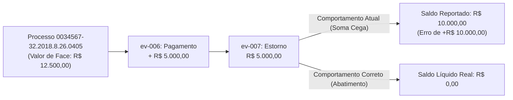

# Impactos no Negócio e na Operação

Este documento traduz as falhas técnicas diagnosticadas em [`investigacao.md`](investigacao.md) e [`diagnostico.md`](diagnostico.md) em impactos financeiros, estratégicos e operacionais quantificados sobre a carteira analisada.

---

## Síntese Executiva de Impactos Quantificados

| Dimensão | Indicador Afetado na Amostra | Magnitude / Distorção | Causa Principal |
|---|---|---|---|
| **Financeira (Saldo Pago)** | Distorção por estorno somado (`0034567-32.2018.8.26.0405`) | **+R\$ 10.000,00** de saldo fantasma (R\$ 10.000 reportados vs R\$ 0,00 real) | Soma cega de `tipo = 'estorno'` (`ev-007`) + falta de `UNIQUE (evento_id)`. |
| **Financeira (Recebimentos)** | Pagamentos reais omitidos ou em risco de descarte | **R\$ 7.700,50** (`ev-002`, `ev-005`, `ev-011`) | Política *fail-silent* combinada a formato PT-BR, CNJ sem máscara e processo ausente no Hub. |
| **Estratégica (Fluxo de Caixa)** | Precatórios com vencimento postergado em 1 ano | **R\$ 67.000,00** em valor de face (40% dos processos do Hub) | Erro no corte `<= 02/04` e ausência de conversão do fuso UTC para Brasília (`-03:00`). |
| **Cadastral e Risco de Crédito** | Conflito de valor de face e troca de esfera devedora | **R\$ 1.000,00** de diferença + troca **Município vs União** | Conciliação manual no Excel mascarada por erros de formatação. |

---

## 1. Inflação e Distorção do Saldo Pago (Impacto Financeiro Direto)

- **Multiplicação de pagamentos a cada ciclo diário:** Como o tribunal reenvia os eventos dos últimos 7 dias diariamente e a tabela `pagamento` não possui restrição `UNIQUE (evento_id)`, qualquer reenvio ou reexecução manual do script soma novamente valores já contabilizados. No lote analisado, `ev-001` aparece duas vezes (`15.000,00` e retificação de `15.500,00`) e `ev-002` (`2.500,50`) está duplicado.
- **Contabilização invertida de estornos:** O evento `ev-007` (`estorno` de R\$ 5.000,00 no processo `0034567-32.2018.8.26.0405`), ao ser somado em vez de subtraído, gera uma distorção imediata de **R\$ 10.000,00** no saldo do processo:

---

## 2. Perda Silenciosa de Eventos Financeiros (Cegueira Operacional)

Como o script ignora falhas sem gerar log ou alerta ([item 5 do Fluxo Operacional](../case-candidato/ENUNCIADO.md#o-fluxo-operacional)), a operação perde visibilidade sobre dois grupos críticos de eventos:

1. **Pagamentos legítimos descartados por formatação ou sincronismo (R\$ 7.700,50 na amostra):**
   - `ev-002` (**R\$ 2.500,50**): Rejeitado por estar formatado como string PT-BR (`"2.500,50"`) e data `DD/MM/AAAA`.
   - `ev-005` (**R\$ 1.200,00**): Risco de falha no *lookup* por vir com número CNJ sem pontuação (`00234562120208260053`).
   - `ev-011` (**R\$ 4.000,00**): Rejeitado por violação de chave estrangeira (`precatorio_id`), pois o processo `0067890-65.2016.8.26.0053` ainda não estava cadastrado no `hub.csv`.
2. **Anomalias que exigem atuação junto ao Tribunal e desaparecem sem trilha de auditoria:**
   - `ev-004` (`valor: null`), `ev-009` (`valor: -200` com `tipo: "pagamento"`) e `ev-010` (`processo: ""`).

---

## 3. Priorização Incorreta da Carteira (Impacto Estratégico e de Caixa)

A equipe de operações prioriza o acompanhamento e a projeção de recebimento da carteira com base no campo `prazo_pagamento` ([item 4 do Fluxo Operacional](../case-candidato/ENUNCIADO.md#o-fluxo-operacional)).

> [!IMPORTANT]
> Dois dos cinco processos do `hub.csv` — totalizando **R\$ 67.000,00 em valor de face** (mais de 56% do valor financeiro cadastrado no Hub) — tiveram a previsão de recebimento postergada indevidamente de **dezembro/2026 para dezembro/2027** (1 ano de defasagem na projeção de liquidez):

| Processo (CNJ) | Valor de Face | Apresentado em (Bruto) | Data Civil (Brasília) | Prazo no Hub (Incorreto) | Prazo Real (Constitucional) |
|---|---:|---|---|---|---|
| `0012345-10.2019.8.26.0053` | R\$ 45.000,00 | `2025-04-02` | `2025-04-02` (≤ 02/04) | `2027-12-31` ❌ | **`2026-12-31`** |
| `0056789-54.2017.4.03.6100` | R\$ 22.000,00 | `2025-04-03T01:00:00Z` | `2025-04-02` às 22h (≤ 02/04) | `2027-12-31` ❌ | **`2026-12-31`** |

---

## 4. Quebra da Conciliação Semanal Hub vs Tribunal (Risco Cadastral e de Crédito)

A ausência de normalização de texto (`MUNICIPIO DE SAO PAULO` vs `Município de São Paulo`), a mistura de CNJs com e sem máscara e a corrupção do `tribunal.csv` pelo Excel (convertendo `,` em `;` e `UTF-8` em `Windows-1252`) geram ruído operacional constante. Enquanto o operador trata divergências superficiais de formatação, **inconsistências estruturais graves** permanecem ocultas:

- **Divergência de Valor de Face:** Diferença de **R\$ 1.000,00** no processo `0023456-21.2020.8.26.0053` (R\$ 31.000,00 no Hub vs R\$ 30.000,00 no Tribunal).
- **Risco de Crédito e Esfera Orçamentária:** O processo `0045678-43.2021.5.02.0011` está classificado como dívida do **`Município de Santos`** no Hub, mas consta como **`União`** no Tribunal — alterando completamente o regime de pagamento, o teto orçamentário e o risco soberano do ativo.
- **Desalinhamento de Carteira Ativa:** Existência de precatório com pagamento ativo no Tribunal sem cadastro no Hub (`0067890-65.2016.8.26.0053`) e precatório ativo no Hub omitido na listagem semanal do Tribunal (`0056789-54.2017.4.03.6100`).
