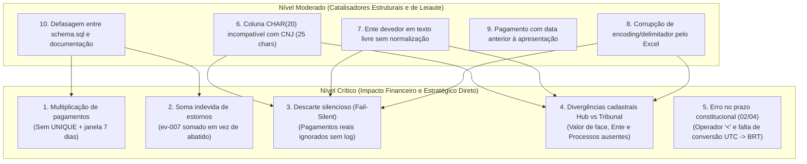

# Diagnóstico Técnico por Nível de Severidade

Este documento classifica as falhas identificadas na [Investigação Exploratória](investigacao.md) em **ordem decrescente de gravidade**, distinguindo **causas raiz** de **consequências operacionais**.

---

## 1. Nível Crítico (Risco Financeiro e Operacional Imediato)

Problemas que distorcem diretamente o saldo financeiro da carteira, descartam eventos válidos sem rastreabilidade ou comprometem a projeção de fluxo de caixa.

### 1.1. Multiplicação de pagamentos por ausência de idempotência
- **Classificação:** **Causa Raiz**
- **Evidência:** Em [`pagamentos.json`](../case-candidato/dados/pagamentos.json), `ev-002` está duplicado (linhas 11 e 27) e `ev-001` aparece duas vezes devido a uma retificação de valor (`15000.0` em `10/03` para `15500.0` em `11/03`). Paralelamente, a coluna `evento_id` em [`schema.sql`](../case-candidato/schema.sql#L11) não possui restrição `UNIQUE`.
- **Mecanismo da Falha:** O tribunal reenvia diariamente uma janela móvel dos últimos 7 dias e o operador reexecuta o script manualmente em caso de erro ([itens 1 e 2 do Fluxo Operacional](../case-candidato/ENUNCIADO.md#o-fluxo-operacional)). Sem `UNIQUE (evento_id)` e lógica de *Upsert*, cada execução acumula valores repetidos.
- **Impacto Associado:** [Inflação e distorção do saldo pago](Impactos.md#1-infla%C3%A7%C3%A3o-e-distor%C3%A7%C3%A3o-do-saldo-pago-impacto-financeiro-direto).

### 1.2. Contabilização de estornos como pagamentos positivos
- **Classificação:** **Causa Raiz**
- **Evidência:** O evento `ev-007` em [`pagamentos.json`](../case-candidato/dados/pagamentos.json#L59-L65) possui `"tipo": "estorno"` e `"valor": 5000` (referente ao processo `0034567-32.2018.8.26.0405`), contradizendo [`DOCUMENTACAO_TRIBUNAL.md`](../case-candidato/DOCUMENTACAO_TRIBUNAL.md#L15), que afirma que o campo `tipo` é sempre `"pagamento"`.
- **Mecanismo da Falha:** O script de importação *"soma cada valor ao total pago"* ([item 2 do Fluxo Operacional](../case-candidato/ENUNCIADO.md#o-fluxo-operacional)) sem avaliar a natureza da operação (`pagamento` vs `estorno`). O processo, cujo saldo líquido deveria ser **R\$ 0,00** (`+5000` de `ev-006` e `-5000` de `ev-007`), passa a exibir **R\$ 10.000,00** pagos.

### 1.3. Descarte silencioso de eventos (*Fail-Silent*)
- **Classificação:** **Consequência** (da ausência de camada de normalização aliada à política de ignorar erros sem log)
- **Evidência:** Conforme o [item 5 do Fluxo Operacional](../case-candidato/ENUNCIADO.md#o-fluxo-operacional), qualquer falha faz o script descartar o registro sem alerta. Isso impacta **6 eventos** do lote analisado:
  - `ev-002`: Valor em formato string PT-BR (`"2.500,50"`) e data em `DD/MM/AAAA` (`"10/04/2025"`).
  - `ev-004`: Valor nulo (`null`), violando `NOT NULL`.
  - `ev-005`: Processo sem pontuação CNJ (`"00234562120208260053"`), falhando no vínculo por string exata.
  - `ev-009`: Valor negativo (`-200`), violando `CHECK (valor > 0)`.
  - `ev-010`: Campo `processo` vazio (`""`).
  - `ev-011`: Pagamento de R\$ 4.000,00 para processo (`0067890-65.2016.8.26.0053`) ainda não cadastrado no `hub.csv` (falha de chave estrangeira `precatorio_id`).

### 1.4. Divergências cadastrais críticas entre `hub.csv` e `tribunal.csv`
- **Classificação:** **Consequência** (da conciliação manual frágil e ausência de sincronização automatizada)
- **Evidência:**
  - **Omissão de Processos:** `0067890-65.2016.8.26.0053` existe no Tribunal, foi apresentado e recebeu pagamento (`ev-011`), mas não consta no Hub. Inversamente, `0056789-54.2017.4.03.6100` está no Hub, mas não veio em `tribunal.csv`.
  - **Conflito de Ente Devedor:** `0045678-43.2021.5.02.0011` consta como `Município de Santos` no Hub e como `União` no Tribunal.
  - **Conflito de Valor de Face:** `0023456-21.2020.8.26.0053` registra `31000.00` no Hub e `30.000,00` no Tribunal.

### 1.5. Cálculo incorreto do prazo constitucional (Regra de 2 de abril e Fuso Horário)
- **Classificação:** **Causa Raiz** (de erro na priorização da carteira)
- **Evidência:** Precatórios apresentados **até 2 de abril** vencem em `31/12` do ano seguinte; após essa data, vencem em `31/12` de dois anos à frente. Em [`hub.csv`](../case-candidato/dados/hub.csv):
  - `0012345-10.2019.8.26.0053` (`apresentado_em = 2025-04-02`): Calculado como `2027-12-31` por erro de operador lógico (`< 02/04` em vez de `<= 02/04`). O prazo correto é **`2026-12-31`**.
  - `0056789-54.2017.4.03.6100` (`apresentado_em = 2025-04-03T01:00:00Z`): Convertido para o fuso de Brasília (`America/Sao_Paulo`, `-03:00`), o protocolo ocorreu em **`2025-04-02` às 22h00**. O sistema utilizou a data UTC bruta e projetou `2027-12-31` em vez de **`2026-12-31`**.

---

## 2. Nível Moderado (Problemas Estruturais, de Modelagem e Leiaute)

Falhas de modelagem, formatação e processo que inviabilizam a conciliação direta e alimentam os erros críticos.

| # | Problema Identificado | Tipo | Evidência Técnica | Efeito na Operação |
|---|---|---|---|---|
| **2.1** | **Coluna `CHAR(20)` incompatível com máscara CNJ** | Causa | [`schema.sql`](../case-candidato/schema.sql#L3) define `CHAR(20)`, mas o padrão CNJ formatado (`NNNNNNN-DD.AAAA.J.TR.OOOO`) exige **25 caracteres**. | Força o armazenamento sem pontuação em parte da base (`00234562120208260053`), quebrando comparações exatas. |
| **2.2** | **Ente devedor sem normalização (`TEXT` livre)** | Causa | Em [`hub.csv`](../case-candidato/dados/hub.csv#L2-L3) coexistem `MUNICIPIO DE SAO PAULO` e `Município de São Paulo`. | Gera falsos negativos na conferência semanal entre Hub e Tribunal. |
| **2.3** | **Corrupção de `tribunal.csv` via Excel** | Consequência | O arquivo real veio em `Windows-1252`, delimitado por `;` e com valores `45.000,00`, divergindo do contrato (`UTF-8`, `,`, `.`). | Efeito direto do [item 3 do Fluxo Operacional](../case-candidato/ENUNCIADO.md#o-fluxo-operacional) (abrir e salvar no Excel PT-BR antes de conciliar). |
| **2.4** | **Anomalia cronológica (Pagamento < Apresentação)** | Consequência | No processo `0012345-10.2019.8.26.0053`, o pagamento `ev-001` (`2025-03-10`) antecede a apresentação (`2025-04-02`). | Indica erro cadastral na data de apresentação ou imputação de pagamento em processo incorreto. |
| **2.5** | **Defasagem entre `schema.sql` e Documentação** | Causa | `apresentacoes.json` não está documentado; `precatorio` em `schema.sql` não possui `apresentado_em` nem `prazo_pagamento`. | Fragiliza a integração e impede auditoria de prazos diretamente no banco de dados. |
