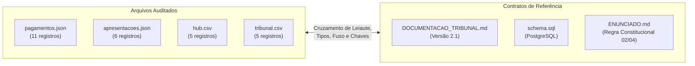

# Investigação Exploratória de Dados e Contratos

Este documento consolida a auditoria técnica realizada sobre os arquivos brutos recebidos em `case-candidato/dados/`, confrontando-os com a [Especificação do Tribunal](../case-candidato/DOCUMENTACAO_TRIBUNAL.md), o [Fluxo Operacional](../case-candidato/ENUNCIADO.md#o-fluxo-operacional) e o [Esquema do Banco de Dados (`schema.sql`)](../case-candidato/schema.sql).

---

## 1. Análise de `pagamentos.json`

Confrontando [`pagamentos.json`](../case-candidato/dados/pagamentos.json) com a [especificação oficial](../case-candidato/DOCUMENTACAO_TRIBUNAL.md#pagamentosjson), foram identificadas quebras de unicidade, tipagem, formato e domínio em **7 dos 11 registros** enviados:

| Evento ID | Processo (CNJ) | Campo Afetado | Valor Encontrado | Especificação Oficial | Anomalia Detectada |
|---|---|---|---|---|---|
| `ev-001` | `0012345-10.2019.8.26.0053` | `evento_id` / `valor` | `15000.0` (dia 10) e `15500.0` (dia 11) | ID único por evento | **Retificação:** Mesmo ID enviado duas vezes com `atualizado_em` e valores distintos. |
| `ev-002` | `0012345-10.2019.8.26.0053` | `evento_id` / `valor` / `data_pagamento` | Duplicado; `"2.500,50"`; `"10/04/2025"` | Único; Número (`.`); `AAAA-MM-DD` | **Duplicata exata** (linhas 11 e 27), valor como `string` PT-BR e data em `DD/MM/AAAA`. |
| `ev-004` | `0023456-21.2020.8.26.0053` | `valor` | `null` | Número (`NOT NULL`) | **Valor ausente:** Inviabiliza contabilização financeira e viola `schema.sql`. |
| `ev-005` | `00234562120208260053` | `processo` | `"00234562120208260053"` (20 chars) | `NNNNNNN-DD.AAAA.J.TR.OOOO` | **Sem máscara CNJ:** Ausência de pontos e hífen. |
| `ev-007` | `0034567-32.2018.8.26.0405` | `tipo` | `"estorno"` (`5000`) | Sempre `"pagamento"` | **Quebra de contrato:** Evento de estorno não previsto na documentação, mas existente no `schema.sql`. |
| `ev-009` | `0056789-54.2017.4.03.6100` | `valor` | `-200` (`tipo: "pagamento"`) | Número positivo (`> 0`) | **Valor negativo:** Viola a constraint `CHECK (valor > 0)` do banco de dados. |
| `ev-010` | *(vazio)* | `processo` | `""` | Padrão CNJ (25 chars) | **Registro órfão:** Pagamento de `750` sem número de processo vinculado. |

---

## 2. Análise de `apresentacoes.json`

O arquivo [`apresentacoes.json`](../case-candidato/dados/apresentacoes.json) registra o momento de apresentação de cada precatório ao tribunal, dado determinante para o cálculo do vencimento constitucional.

> [!WARNING]
> **Fonte não documentada:** O arquivo `apresentacoes.json` não consta na versão 2.1 de [`DOCUMENTACAO_TRIBUNAL.md`](../case-candidato/DOCUMENTACAO_TRIBUNAL.md), operando sem definição formal de formato de data ou fuso horário.

| Processo (CNJ) | `apresentado_em` (Bruto) | Formato Recebido | Data Civil em Brasília (`-03:00`) | Observação Técnica |
|---|---|---|---|---|
| `0012345-10.2019.8.26.0053` | `2025-04-02` | Data ISO (`AAAA-MM-DD`) | `2025-04-02` | Possui pagamento (`ev-001`) em `2025-03-10` (**anterior à apresentação**). |
| `0023456-21.2020.8.26.0053` | `2025-04-03` | Data ISO (`AAAA-MM-DD`) | `2025-04-03` | Apresentado após o corte constitucional de 2 de abril. |
| `0034567-32.2018.8.26.0405` | `2024-02-29` | Data ISO (`AAAA-MM-DD`) | `2024-02-29` | Ano bissexto válido. |
| `0045678-43.2021.5.02.0011` | `2025-04-02T23:30:00-03:00` | Timestamp ISO c/ offset `-03:00` | `2025-04-02` | Dentro do corte de 2 de abril (23h30 BRT). |
| `0056789-54.2017.4.03.6100` | `2025-04-03T01:00:00Z` | Timestamp ISO em **UTC (`Z`)** | **`2025-04-02`** | **Crítico:** `01:00 UTC` do dia 03/04 equivale a **`22:00 BRT` do dia 02/04**. |
| `0067890-65.2016.8.26.0053` | `2023-12-31` | Data ISO (`AAAA-MM-DD`) | `2023-12-31` | Processo ausente na base interna (`hub.csv`). |

---

## 3. Análise de `hub.csv`

A exportação do sistema interno ([`hub.csv`](../case-candidato/dados/hub.csv)) apresenta falhas de padronização cadastral e erros na implementação da regra constitucional de prazo de pagamento (corte em **2 de abril**):

| Linha | Processo no `hub.csv` | Ente no `hub.csv` | `apresentado_em` | `prazo_pagamento` (Hub) | Prazo Correto (BRT) | Falhas Identificadas |
|---|---|---|---|---|---|---|
| 2 | `0012345-10.2019.8.26.0053` | `MUNICIPIO DE SAO PAULO` | `2025-04-02` | `2027-12-31` ❌ | **`2026-12-31`** | Ente em caixa alta/sem acento; erro de limite (`< 02/04` em vez de `<= 02/04`). |
| 3 | `00234562120208260053` | `Município de São Paulo` | `2025-04-03` | `2027-12-31` ✅ | `2027-12-31` | Processo sem máscara CNJ (20 dígitos puros). |
| 4 | `0034567-32.2018.8.26.0405` | `Estado de São Paulo` | `2024-02-29` | `2025-12-31` ✅ | `2025-12-31` | Registro consistente. |
| 5 | `0045678-43.2021.5.02.0011` | `Município de Santos` | `2025-04-02T23:30:00-03:00` | `2026-12-31` ✅ | `2026-12-31` | `apresentado_em` armazenado com timestamp completo em vez de data. |
| 6 | `0056789-54.2017.4.03.6100` | `Estado de São Paulo` | `2025-04-03T01:00:00Z` | `2027-12-31` ❌ | **`2026-12-31`** | Cálculo feito sobre a data UTC (`03/04`) sem converter para Brasília (`02/04`). |

---

## 4. Análise de `tribunal.csv`

Confrontando [`tribunal.csv`](../case-candidato/dados/tribunal.csv) com a [especificação técnica](../case-candidato/DOCUMENTACAO_TRIBUNAL.md#tribunalcsv), constata-se que o arquivo foi corrompido pela manipulação manual no Microsoft Excel ([item 3 do Fluxo Operacional](../case-candidato/ENUNCIADO.md#o-fluxo-operacional)):

| Atributo | Especificação (`DOCUMENTACAO_TRIBUNAL.md`) | Encontrado em `tribunal.csv` | Causa Técnica |
|---|---|---|---|
| **Codificação (`Encoding`)** | `UTF-8` | `Windows-1252 / Latin-1` (byte `0xED` em `Município`) | Salvamento padrão do Excel em ambiente Windows PT-BR. |
| **Delimitador de Colunas** | Vírgula (`,`) | Ponto e vírgula (`;`) | Configuração regional PT-BR do Excel ao exportar CSV. |
| **Formato de `valor_face`** | Ponto decimal (`45000.00`) | Milhar com `.` e decimal com `,` (`45.000,00`) | Formatação visual aplicada pelo Excel antes de salvar. |

---

## 5. Cruzamento de Bases e Problemas Interligados

A comparação cruzada entre `hub.csv`, `tribunal.csv`, `apresentacoes.json`, `pagamentos.json` e `schema.sql` revela falhas estruturais entre as camadas:

### 5.1. Matriz de Conciliação (`hub.csv` vs `tribunal.csv`)

| Processo (CNJ Normalizado) | Presença nas Bases | Ente Devedor (Hub vs Tribunal) | Valor de Face (Hub vs Tribunal) | Diagnóstico da Conciliação |
|---|---|---|---|---|
| `0012345-10.2019.8.26.0053` | Ambos | `MUNICIPIO DE SAO PAULO` vs `Município de São Paulo` | `45000.00` vs `45.000,00` | **Conciliável após normalização** de grafia e formato numérico. |
| `0023456-21.2020.8.26.0053` | Ambos | `Município de São Paulo` (Ambos) | **`31000.00` vs `30.000,00`** | **Divergência Financeira:** Diferença de R\$ 1.000,00 no valor de face. |
| `0034567-32.2018.8.26.0405` | Ambos | `Estado de São Paulo` (Ambos) | `12500.00` vs `12.500,00` | **Conciliável após normalização** (saldo líquido R\$ 0,00 após estorno `ev-007`). |
| `0045678-43.2021.5.02.0011` | Ambos | **`Município de Santos` vs `União`** | `9800.00` vs `9.800,00` | **Divergência de Devedor:** Conflito entre esfera municipal e federal (TRT-2 / `5.02`). |
| `0056789-54.2017.4.03.6100` | **Apenas Hub** | `Estado de São Paulo` (Hub) | `22000.00` (Hub) | **Ausente no Tribunal:** Consta no Hub, em `apresentacoes.json` e tem `ev-009`. |
| `0067890-65.2016.8.26.0053` | **Apenas Tribunal** | `Município de São Paulo` (Tribunal) | `7.000,00` (Tribunal) | **Ausente no Hub:** Consta no Tribunal, em `apresentacoes.json` e tem pagamento `ev-011` (R\$ 4.000,00). |

### 5.2. Incompatibilidades com o Banco de Dados (`schema.sql`)
1. **Truncamento/Rejeição de CNJ (`CHAR(20)` vs 25 caracteres):** A coluna `numero_processo CHAR(20)` em [`schema.sql`](../case-candidato/schema.sql#L3) comporta apenas os 20 dígitos sem pontuação, sendo incompatível com o formato CNJ oficial de 25 caracteres (`NNNNNNN-DD.AAAA.J.TR.OOOO`).
2. **Ausência de Idempotência (`evento_id` sem `UNIQUE`):** A tabela `pagamento` permite múltiplas inserções do mesmo `evento_id`, multiplicando saldos a cada reenvio da janela móvel de 7 dias ou reexecução manual do script.
3. **Soma Indevida de Estornos:** Embora o banco preveja `CHECK (tipo IN ('pagamento', 'estorno'))`, o script operacional soma todos os registros indistintamente, transformando um abatimento de R\$ 5.000,00 (`ev-007`) em um acréscimo de R\$ 5.000,00.
4. **Lacuna de Modelagem em `precatorio`:** As colunas `apresentado_em` e `prazo_pagamento`, essenciais para a priorização da carteira e exportadas no `hub.csv`, não existem na definição de [`schema.sql`](../case-candidato/schema.sql#L1-L6).
