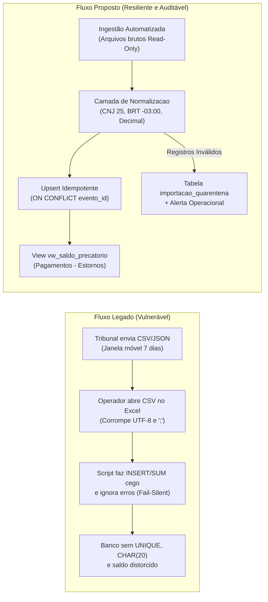
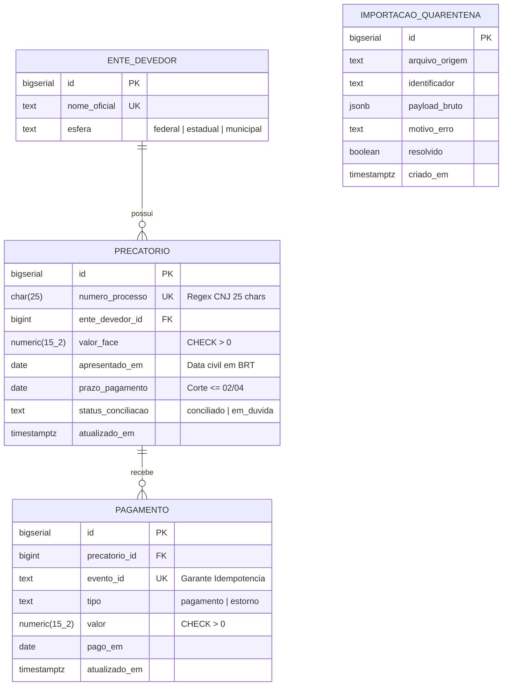

<a id="prevencao"></a>
# Plano de Prevenção e Evolução Arquitetural (Processo, Pipeline e SQL)

Este documento apresenta as medidas definitivas no **processo operacional**, no **pipeline de ingestão** e na **modelagem do banco de dados (PostgreSQL)** para eliminar na origem as falhas identificadas no diagnóstico ([item 3 do Enunciado](../case-candidato/ENUNCIADO.md#o-que-pedimos)).



---

## 1. Mudanças no Processo Operacional

| Frente Operacional | Problema Atual | Ação Preventiva Definitiva |
|---|---|---|
| **Eliminação do Excel na Ingestão** | O operador abre e salva `tribunal.csv` no Excel antes da comparação ([item 3 do Fluxo](../case-candidato/ENUNCIADO.md#o-fluxo-operacional)), alterando o encoding para `Windows-1252`, o delimitador para `;` e o formato numérico para `45.000,00`. | Tratar os diretórios de recepção do tribunal como **somente leitura (imutáveis)**. O pipeline Python lê o arquivo original diretamente e exporta relatórios já conciliados ([`relatorio_limpeza.md`](../output/relatorio_limpeza.md)) para análise da equipe. |
| **Revisão do Contrato de Integração (v2.2)** | `apresentacoes.json` não possui especificação; `"estorno"` e retificações por `atualizado_em` contradizem a documentação v2.1. | Formalizar junto à TI do Tribunal o aditivo da especificação técnica contendo o esquema de `apresentacoes.json`, a semântica de `atualizado_em` e as regras de estorno. |

---

## 2. Mudanças no Pipeline de Importação

1. **Idempotência Transacional (*Upsert* por `evento_id` + controle de versão por `atualizado_em`):**
   - Como o tribunal reenvia os últimos 7 dias diariamente e o script pode ser reexecutado após falhas, a rotina nunca deve realizar `SUM` incremental ou `INSERT` sem verificação.
   - Utilizar `INSERT ... ON CONFLICT (evento_id) DO UPDATE` condicionado a `EXCLUDED.atualizado_em > pagamento.atualizado_em` dentro de uma transação atômica.
2. **Contabilização Líquida por Natureza do Evento (`pagamento` vs `estorno`):**
   - Substituir a soma indiscriminada por cálculo algébrico: somar quando `tipo = 'pagamento'` e **subtrair** quando `tipo = 'estorno'`.
3. **Camada de Normalização e Quarentena (Substituição do *Fail-Silent*):**
   - Validar e normalizar todos os payloads na entrada via [`src/normalizacao.py`](../src/normalizacao.py) (máscara CNJ de 25 caracteres, conversão de timestamps UTC para `America/Sao_Paulo` antes da regra `<= 02 de abril` e conversão monetária para `Decimal`).
   - Substituir o descarte silencioso pela gravação na tabela `importacao_quarentena`, gerando alerta imediato para a operação sempre que houver `valor <= 0`, `valor IS NULL`, `processo` ausente ou divergência entre Hub e Tribunal.

---

## 3. Evolução do Banco de Dados (DDL SQL)

### 3.1. Comparativo de Modelagem (`schema.sql` Atual vs Novo Schema)

| Elemento | `schema.sql` Atual | Novo Schema Proposto | Benefício Direto |
|---|---|---|---|
| `precatorio.numero_processo` | `CHAR(20)` | `CHAR(25)` + `CHECK (Regex CNJ)` | Suporta a máscara CNJ oficial (`NNNNNNN-DD.AAAA.J.TR.OOOO`) e impede inserção fora do padrão. |
| `precatorio.ente_devedor` | `TEXT` livre | FK `ente_devedor_id` → tabela `ente_devedor` | Elimina duplicidade de grafia/acentuação (`MUNICIPIO DE SAO PAULO` vs `Município de São Paulo`). |
| Datas de Prazo Constitucional | *(Ausentes no banco)* | `apresentado_em DATE` e `prazo_pagamento DATE` | Permite auditar e consultar a priorização constitucional da carteira diretamente via SQL. |
| `pagamento.evento_id` | `TEXT NOT NULL` (sem `UNIQUE`) | `TEXT NOT NULL UNIQUE` + `atualizado_em` | Garante idempotência nos reenvios diários de 7 dias e permite retificações seguras via *Upsert*. |
| Auditoria de Erros | *(Inexistente — Fail-Silent)* | Tabela `importacao_quarentena` (`JSONB`) | Rastreabilidade total de registros rejeitados sem interromper o processamento dos eventos válidos. |

### 3.2. Diagrama Entidade-Relacionamento (Novo Schema)



### 3.3. Script DDL e Query de Upsert (PostgreSQL)

```sql
-- 1. Tabela de domínio para padronizar Entes Devedores (elimina texto livre inconsistente)
CREATE TABLE ente_devedor (
    id           BIGSERIAL PRIMARY KEY,
    nome_oficial TEXT      NOT NULL UNIQUE,
    esfera       TEXT      NOT NULL CHECK (esfera IN ('federal', 'estadual', 'municipal'))
);

-- 2. Tabela de Precatórios evoluída
CREATE TABLE precatorio (
    id                 BIGSERIAL     PRIMARY KEY,
    -- Padrão CNJ formatado (NNNNNNN-DD.AAAA.J.TR.OOOO) possui 25 caracteres
    numero_processo    CHAR(25)      NOT NULL UNIQUE
        CHECK (numero_processo ~ '^[0-9]{7}-[0-9]{2}\.[0-9]{4}\.[0-9]\.[0-9]{2}\.[0-9]{4}$'),
    ente_devedor_id    BIGINT        NOT NULL REFERENCES ente_devedor (id),
    valor_face         NUMERIC(15,2) NOT NULL CHECK (valor_face > 0),
    apresentado_em     DATE          NOT NULL,
    -- Calculado sempre com data de apresentação no fuso America/Sao_Paulo (corte <= 02 de abril)
    prazo_pagamento    DATE          NOT NULL,
    status_conciliacao TEXT          NOT NULL DEFAULT 'conciliado'
        CHECK (status_conciliacao IN ('conciliado', 'em_duvida')),
    atualizado_em      TIMESTAMPTZ   NOT NULL DEFAULT now()
);

-- 3. Tabela de Pagamentos idempotente
CREATE TABLE pagamento (
    id            BIGSERIAL     PRIMARY KEY,
    precatorio_id BIGINT        NOT NULL REFERENCES precatorio (id),
    -- Constraint UNIQUE garante idempotência nos reenvios de 7 dias e reexecuções
    evento_id     TEXT          NOT NULL UNIQUE,
    tipo          TEXT          NOT NULL CHECK (tipo IN ('pagamento', 'estorno')),
    valor         NUMERIC(15,2) NOT NULL CHECK (valor > 0),
    pago_em       DATE          NOT NULL,
    atualizado_em TIMESTAMPTZ   NOT NULL,
    criado_em     TIMESTAMPTZ   NOT NULL DEFAULT now()
);

-- 4. Tabela de Quarentena / Auditoria (substitui o descarte silencioso)
CREATE TABLE importacao_quarentena (
    id             BIGSERIAL   PRIMARY KEY,
    arquivo_origem TEXT        NOT NULL,
    identificador  TEXT        NOT NULL,
    payload_bruto  JSONB       NOT NULL,
    motivo_erro    TEXT        NOT NULL,
    resolvido      BOOLEAN     NOT NULL DEFAULT FALSE,
    criado_em      TIMESTAMPTZ NOT NULL DEFAULT now()
);

-- 5. View para saldo pago líquido por precatório (soma pagamentos e subtrai estornos)
CREATE VIEW vw_saldo_precatorio AS
SELECT
    p.id AS precatorio_id,
    p.numero_processo,
    p.valor_face,
    p.apresentado_em,
    p.prazo_pagamento,
    COALESCE(
        SUM(
            CASE
                WHEN pg.tipo = 'pagamento' THEN pg.valor
                WHEN pg.tipo = 'estorno'   THEN -pg.valor
            END
        ),
        0.00
    )::NUMERIC(15,2) AS total_pago_liquido
FROM precatorio p
LEFT JOIN pagamento pg ON pg.precatorio_id = p.id
GROUP BY p.id, p.numero_processo, p.valor_face, p.apresentado_em, p.prazo_pagamento;

-- 6. Comando de UPSERT idempotente utilizado pelo pipeline de importação
-- Atualiza o registro apenas se o evento recebido possuir timestamp mais recente:
INSERT INTO pagamento (precatorio_id, evento_id, tipo, valor, pago_em, atualizado_em)
VALUES (:precatorio_id, :evento_id, :tipo, :valor, :pago_em, :atualizado_em)
ON CONFLICT (evento_id) DO UPDATE
SET
    tipo          = EXCLUDED.tipo,
    valor         = EXCLUDED.valor,
    pago_em       = EXCLUDED.pago_em,
    atualizado_em = EXCLUDED.atualizado_em
WHERE EXCLUDED.atualizado_em > pagamento.atualizado_em;
```
