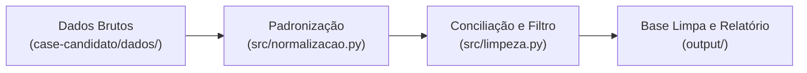

# Análise e Conciliação de Precatórios


Diagnóstico, limpeza de dados em Python e correção do banco SQL para os arquivos de precatórios do case.

---

## Diagnóstico

Classificação do mais grave ao menos grave (detalhes em [`diagnostico.md`](investigacoes/diagnostico.md)):

### [Nível Crítico](investigacoes/diagnostico.md#critico)
- **Pagamentos somados mais de uma vez:** o tribunal reenvia os últimos 7 dias todos os dias. Como [`pagamentos.json`](investigacoes/investigacao.md#pagamentosjson) traz IDs repetidos (`ev-001` e `ev-002`) e a tabela `pagamento` não tem `UNIQUE (evento_id)`, o script soma o mesmo pagamento várias vezes.
- **Estorno somado como pagamento:** o evento `ev-007` é um `"estorno"` de R\$ 5.000,00. O script atual soma esse valor em vez de subtrair, gerando R\$ 10.000,00 de erro no saldo.
- **Erros descartados sem aviso:** o script ignora falhas sem gerar log. Pagamentos válidos fora do formato (`ev-002`, `ev-005`, `ev-011`) e registros defeituosos (`ev-004`, `ev-009`, `ev-010`) somem sem alerta.
- **Prazo de vencimento errado:** precatórios apresentados até **2 de abril** vencem no fim do ano seguinte. Em [`hub.csv`](investigacoes/investigacao.md#hubcsv), dois processos apresentados em 2 de abril (um deles em fuso UTC: `2025-04-03T01:00:00Z`, que é `02/04` às 22h em Brasília) tiveram o prazo jogado de 2026 para 2027.

### [Nível Moderado](investigacoes/diagnostico.md#razoavel)
- **CSV alterado pelo Excel:** ao abrir e salvar [`tribunal.csv`](investigacoes/investigacao.md#tribunalcsv) no Excel, a codificação mudou de `UTF-8` para `Windows-1252`, o separador virou `;` e os números ganharam formato `45.000,00`.
- **Diferenças entre Hub e Tribunal:** o banco define `CHAR(20)` para processos que têm 25 caracteres no padrão CNJ. Além disso, há entes com grafias diferentes, divergência de valor de face, troca de devedor e processos que só existem em uma das bases.

---

## Documentação

- [Investigação dos Arquivos](investigacoes/investigacao.md)
- [Diagnóstico por Gravidade](investigacoes/diagnostico.md)
- [Impactos no Negócio](investigacoes/Impactos.md)
- [Prevenção e Novo SQL](investigacoes/prevencao.md#prevencao)
- [Perguntas para Operação e Tribunal](investigacoes/perguntas.md#perguntas)
- [Relatório Gerado pelo Script](output/relatorio_limpeza.md)
- **Arquivos do Case:** [Enunciado](case-candidato/ENUNCIADO.md) | [Documentação do Tribunal](case-candidato/DOCUMENTACAO_TRIBUNAL.md) | [Schema SQL Original](case-candidato/schema.sql)

---

## Estrutura do Código

Escrito apenas com a biblioteca padrão do Python 3.10+:
- [`src/normalizacao.py`](src/normalizacao.py): padroniza número CNJ (25 caracteres), nome do ente, valores (`Decimal`), datas e fuso de Brasília (`America/Sao_Paulo`).
- [`src/limpeza.py`](src/limpeza.py): lê os arquivos brutos, cruza as bases, filtra os pagamentos e grava os resultados em `output/`.



---

## Como Executar

Os arquivos originais em `case-candidato/dados/` não são alterados.

```bash
# Gerar arquivos limpos e relatório em output/
python3 main.py

# Rodar testes
python3 -m unittest discover -s tests -v
```

Arquivos gerados em `output/`:
- [`output/precatorios_limpos.csv`](output/precatorios_limpos.csv): precatórios padronizados com prazo corrigido e saldo líquido.
- [`output/pagamentos_limpos.json`](output/pagamentos_limpos.json): pagamentos e estornos válidos, sem duplicatas.
- [`output/relatorio_limpeza.md`](output/relatorio_limpeza.md) e [`output/relatorio_limpeza.json`](output/relatorio_limpeza.json): registro do que foi corrigido, descartado ou deixado em dúvida.

---

## Uso de IA e Conferência

- **Uso de IA:** organização dos textos em Markdown, estrutura dos módulos `src/normalizacao.py` e `src/limpeza.py` e criação dos testes em `tests/test_limpeza.py`.
- **Conferência:** revisão manual de todos os registros dos 4 arquivos de entrada contra o relatório gerado e execução dos testes cobrindo fuso horário em 2 de abril, atualização de `ev-001`, duplicata `ev-002`, estorno `ev-007` e leitura em `Windows-1252`.
