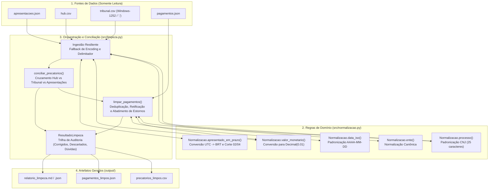
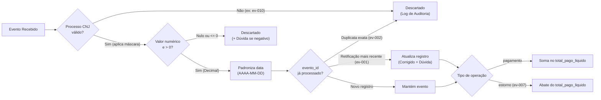

# Case Técnico — Análise e Conciliação de Precatórios


-007EC6?style=flat-square)

Pipeline de saneamento, conciliação e auditoria de dados de precatórios judiciais. O projeto diagnostica inconsistências entre as bases de integração ([`ENUNCIADO.md`](case-candidato/ENUNCIADO.md), [`DOCUMENTACAO_TRIBUNAL.md`](case-candidato/DOCUMENTACAO_TRIBUNAL.md) e [`schema.sql`](case-candidato/schema.sql)), executa o tratamento automatizado em Python e propõe melhorias estruturais em SQL para prevenção de falhas na origem.

---

## 1. Diagnóstico Executivo (Ordem Decrescente de Gravidade)

Os problemas identificados foram classificados por criticidade e impacto operacional. O detalhamento técnico encontra-se em [`diagnostico.md`](investigacoes/diagnostico.md).

### 1.1. [Nível Crítico](investigacoes/diagnostico.md#critico) — Distorção Financeira e de Prazos
- **Inconsistências em [`pagamentos.json`](investigacoes/investigacao.md#pagamentosjson):** O arquivo recebido diverge da [especificação do tribunal](case-candidato/DOCUMENTACAO_TRIBUNAL.md#pagamentosjson). Contém identificadores duplicados (`ev-002`), retificações de valor no mesmo identificador (`ev-001`), formatos monetários inválidos (strings em padrão PT-BR, valores negativos como `-200` e `null`) e eventos de `estorno` (`ev-007`) onde o contrato prevê apenas `"pagamento"`.
- **Reprocessamento sem idempotência:** Conforme o [fluxo operacional](case-candidato/ENUNCIADO.md#o-fluxo-operacional), o tribunal reenvia diariamente uma janela móvel dos últimos 7 dias. A ausência de restrição `UNIQUE (evento_id)` em [`schema.sql`](case-candidato/schema.sql), somada à rotina atual que acumula valores e ignora falhas silenciosamente, infla o saldo pago da carteira.
- **Erro no corte constitucional de 2 de abril:** Timestamps em UTC em [`apresentacoes.json`](investigacoes/investigacao.md#apresenta%C3%A7oesjson) (ex.: `2025-04-03T01:00:00Z`, equivalente a `2025-04-02` às 22h no horário de Brasília) deslocam a data de apresentação e postergam indevidamente o vencimento do precatório em 1 ano.

### 1.2. [Nível Moderado](investigacoes/diagnostico.md#razoavel) — Quebra de Leiaute e Divergência Cadastral
- **Violação de formato em [`tribunal.csv`](investigacoes/investigacao.md#tribunalcsv):** A [documentação](case-candidato/DOCUMENTACAO_TRIBUNAL.md#tribunalcsv) especifica codificação `UTF-8`, delimitador `,`, separador decimal `.` e numeração CNJ com 25 caracteres. O arquivo real foi exportado em `Windows-1252`, delimitado por `;`, com valores formatados em PT-BR e coluna definida como `CHAR(20)` no banco de dados.
- **Falhas de conciliação ([`hub.csv`](investigacoes/investigacao.md#hubcsv) vs [`tribunal.csv`](investigacoes/investigacao.md#tribunalcsv)):** Divergências de grafia e acentuação nos entes devedores, números CNJ sem máscara, diferenças de valor de face e registros presentes em apenas uma das pontas impedem o cruzamento direto das bases.

---

## 2. Índice de Documentação e Entregáveis

| Categoria | Documento | Objetivo |
|---|---|---|
| **Especificação** | [Enunciado do Case](case-candidato/ENUNCIADO.md) | Contexto operacional, regras de negócio e escopo dos entregáveis. |
| **Especificação** | [Documentação do Tribunal](case-candidato/DOCUMENTACAO_TRIBUNAL.md) | Contrato técnico dos arquivos `pagamentos.json` e `tribunal.csv`. |
| **Especificação** | [Schema SQL Atual](case-candidato/schema.sql) | Estrutura original das tabelas `precatorios` e `pagamentos`. |
| **Análise** | [Investigação Exploratória](investigacoes/investigacao.md) | Evidências coletadas por arquivo e cruzamento de anomalias. |
| **Análise** | [Diagnóstico por Severidade](investigacoes/diagnostico.md) | Classificação detalhada das falhas ([Crítico](investigacoes/diagnostico.md#critico) e [Moderado](investigacoes/diagnostico.md#razoavel)). |
| **Análise** | [Impactos no Negócio](investigacoes/Impactos.md) | Reflexos financeiros, operacionais e jurídicos na carteira. |
| **Solução** | [Prevenção e Novo Schema SQL](investigacoes/prevencao.md#prevencao) | Evolução do banco de dados, idempotência e validação na ingestão. |
| **Solução** | [Alinhamento com Stakeholders](investigacoes/perguntas.md#perguntas) | Pontos de definição pendentes junto ao Tribunal e à Operação. |
| **Auditoria** | [Relatório de Limpeza](output/relatorio_limpeza.md) | Resultado consolidado dos registros corrigidos, descartados e em revisão. |

---

## 3. Arquitetura do Pipeline (Python)

A solução foi estruturada como um pipeline **Batch ETL modular**, utilizando exclusivamente a biblioteca padrão do Python 3.10+ (`decimal`, `zoneinfo`, `datetime`, `csv`, `json`, `unittest`). A arquitetura isola as regras de domínio ([`src/normalizacao.py`](src/normalizacao.py)) da camada de ingestão, conciliação e auditoria ([`src/limpeza.py`](src/limpeza.py)).

### 3.1. Fluxo de Processamento de Dados



### 3.2. Regras de Decisão — Eventos Financeiros (`limpar_pagamentos`)



---

## 4. Execução e Testes

O projeto não requer instalação de pacotes externos. Os arquivos brutos em `case-candidato/dados/` são lidos em modo somente leitura e permanecem inalterados.

```bash
# 1. Executar o pipeline de limpeza e conciliação
python3 main.py

# 2. Executar a suíte de testes unitários
python3 -m unittest discover -s tests -v
```

### Artefatos Gerados (`output/`)
- **[`output/precatorios_limpos.csv`](output/precatorios_limpos.csv):** Base consolidada com numeração CNJ formatada (25 caracteres), ente devedor padronizado, prazo constitucional calculado no fuso `America/Sao_Paulo` e saldo líquido pago.
- **[`output/pagamentos_limpos.json`](output/pagamentos_limpos.json):** Eventos financeiros validados, convertidos para tipos estritos e deduplicados por `evento_id` (preservando a atualização mais recente via `atualizado_em`).
- **[`output/relatorio_limpeza.md`](output/relatorio_limpeza.md) / [`output/relatorio_limpeza.json`](output/relatorio_limpeza.json):** Relatório de auditoria classificando todas as ocorrências em **corrigidos**, **descartados** e **em dúvida**.

---

## 5. Governança no Uso de IA e Validação de Qualidade

- **Aplicação de IA:** Utilizada como ferramenta de apoio na estruturação da documentação técnica, organização modular do pipeline (`src/normalizacao.py` e `src/limpeza.py`) e elaboração dos cenários de teste (`tests/test_limpeza.py`).
- **Controle de Qualidade e Verificação:**
  1. **Auditoria Manual de Dados:** Conferência integral dos registros brutos (`pagamentos.json`, `apresentacoes.json`, `hub.csv` e `tribunal.csv`), validando todos os eventos (`ev-001` a `ev-011`) e processos CNJ contra o relatório de saída.
  2. **Testes Automatizados:** Cobertura das regras críticas de negócio, incluindo conversão de fuso horário na virada do corte constitucional (`2025-04-03T01:00:00Z` UTC → `2025-04-02` BRT → vencimento em `2026-12-31`), retificação por timestamp (`ev-001`), descarte de duplicatas (`ev-002`), abatimento de estornos (`ev-007`) e decodificação `Windows-1252`.
